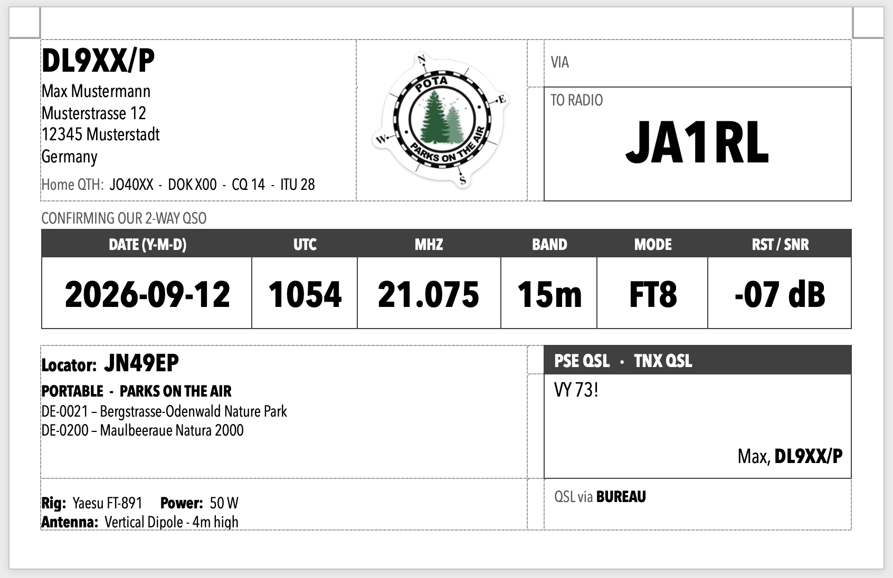
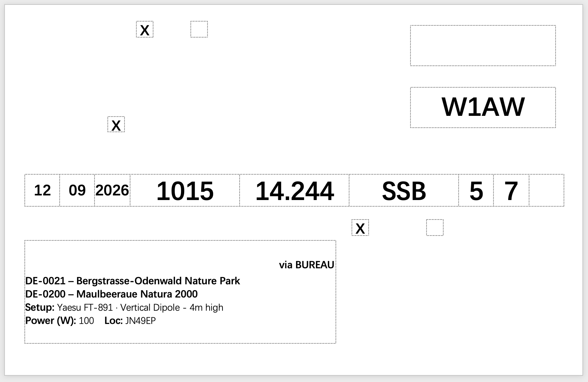

# 📮 wavelog-qsl-convert

> Vom Wavelog-Export zur druckfertigen QSL-Karte — fürs Büro sortiert, mit POTA-Parks, FT8-Rapporten und Umschlägen für Direktkarten.

QSL-Karten von Hand auszufüllen dauert, und ein roher Log-Export passt nicht auf eine Karte: Frequenz in Hz, Datum als `2026-04-14`, FT8-Rapporte, die in kein RST-Kästchen passen, POTA-Referenzen ohne Parknamen. Dieses Tool macht aus einem [Wavelog](https://www.wavelog.org/)-Export (ADIF oder CSV) eine saubere Seriendruck-Datei und bringt Word-Vorlagen mit, die die Karten für dich drucken.



## ✨ Was du bekommst

- **Druckfertige Karten mit einem Befehl.** Mit `--pdf` entsteht direkt ein PDF mit einer Karte pro Seite (140 × 90 mm), ganz ohne Word. Wer lieber in Word arbeitet: Eine CSV speist drei Vorlagen, für Blanko-Karten, für vorgedruckte Karten und für Umschläge.
- **Karten in Büro-Reihenfolge.** Bureau-Karten sind nach Haupt-Prefix gebündelt, so wie das DARC-QSL-Büro sie haben will (USA nach Rufzeichengebiet, inklusive der Trennung W4/WA4). Der Stapel ist sortiert, wenn er aus dem Drucker kommt.
- **Bureau und Direct in einem Export.** Erst kommen die Bureau-Karten, dann die Direktkarten, und jede Karte trägt den Marker `via BUREAU` bzw. `via DIRECT`.
- **Umschläge für Direktkarten.** Die Postanschriften kommen von QRZ.com, auch die von QSL-Managern, die im Feld `QSL_VIA` genannt sind. Umschlag Nr. *n* gehört zu Karte Nr. *n*.
- **POTA inklusive.** Die Parknamen kommen aus der POTA-API und stehen neben der Referenz, bis zu vier Parks pro QSO (n-fer). Die Karte wird automatisch als *Portable* markiert.
- **FT8 richtig dargestellt.** Der SNR steht als `-07 dB` auf der Karte oder verteilt sich auf die drei R/S/T-Kästchen einer vorgedruckten Karte.
- **Dein tatsächlicher Standort.** Die Karte zeigt den Locator, von dem aus du gefunkt hast, nicht nur dein Heimat-QTH.
- **Rig und Antenne auf der Karte**, über zwei einfache Tags im Wavelog-Kommentar.
- **Keine Abhängigkeiten.** Eine Python-Datei, nur Standardbibliothek.

---

## 🚀 Quick Start

### 1. Voraussetzungen

- Python 3.9 oder neuer (keine Zusatzpakete)
- Microsoft Word für die Vorlagen (getestet mit Word für Mac)
- Optional: ein QRZ.com-Konto mit XML-Datenzugriff, für die Umschlag-Adressen

### 2. QSOs aus Wavelog exportieren

Exportiere die QSOs, für die du Karten willst, als **ADIF** (empfohlen) oder CSV, zum Beispiel aus der QSL-Druckwarteschlange von Wavelog. ADIF enthält alles, was die Karten brauchen (Leistung, eigener Locator, POTA-Referenzen, Bureau/Direct).

### 3. Konvertieren

```bash
python3 qsl_convert.py mein-export.adi
```

```
✓ 5 Einträge konvertiert → mein-export_seriendruck.csv
  Versand: BUREAU 4, DIRECT 1
```

Das Ergebnis `mein-export_seriendruck.csv` liegt im aktuellen Verzeichnis. Zum Ausprobieren liegt ein Beispiel-Log bei:

```bash
python3 qsl_convert.py examples/sample.adi --no-qrz
```

### 4a. Direkt als PDF drucken (ohne Word)

Einmalig die Stationsdaten eintragen:

```bash
cp qsl_station.example.ini qsl_station.ini
```

In `qsl_station.ini` Name, Anschrift, Heimat-Locator, DOK und Zonen anpassen. (Fehlt die Datei, legt `--pdf` sie beim ersten Lauf aus der Vorlage an.) Dann:

```bash
python3 qsl_convert.py mein-export.adi --pdf
```

```
✓ 5 Karten (140 × 90 mm) → mein-export_karten.pdf
```

Das PDF enthält eine Karte pro Seite, in derselben Reihenfolge wie die CSV (Bureau sortiert, dann Direct). Es gibt zwei Vorlagen:

- **`--karte blanko`** (Standard): die komplette Rückseite für leere Karten, im Layout von `QSL_Blanko.docx`.
- **`--karte vordruck`**: nur die QSO-Daten als Überdruck auf vorgedruckte Karten, an denselben Positionen wie `QSL_Seriendruck.docx` (Rufzeichen, Datum, Zeit, Frequenz, Mode, RST, `X` für Portable/PSE/TNX, Block mit Parks, Setup, Leistung und Locator). Passen die Positionen nicht zu deinen Karten, sind sie in `qsl_pdf.py` unter `OV_…` als Twips (1/1440 Zoll) hinterlegt.

Die Standardvorlage lässt sich in `qsl_station.ini` mit `vorlage = …` festlegen.

**Drucken:** Das PDF in einem beliebigen Programm öffnen (z. B. Vorschau) und mit **„Tatsächliche Größe“ bzw. 100 %** auf das eigene Kartenformat drucken. Am Vorschaubild im Druckdialog siehst du vorher, ob die Karte vollständig draufpasst.

Zieht dein Drucker die Karte hochkant ein (kurze Seite voraus), stelle in `qsl_station.ini` unter `[pdf]` `rotate = 90` ein. Das PDF hat dann Seiten im Hochformat 90 × 140 mm mit gedrehtem Inhalt, also genau so, wie die Karte durch den Drucker läuft. Steht der Druck auf dem Kopf, `rotate = 270` nehmen.

**Direkt drucken (optional):** Wer immer gleich druckt, trägt in `qsl_station.ini` unter `[pdf]` einen eigenen Druckbefehl ein (`drucken = …`, `{pdf}` steht für die Datei) und startet mit `--drucken`. Das Script kennt keinen Drucker und führt nur diesen Befehl aus; ohne Eintrag passiert nichts.

**Tipp bei AirPrint-Druckern:** Manche Drucker verkleinern eine Seite von sich aus, wenn sie nicht genau zum eingezogenen Papier passt, auch wenn im Druckdialog 100 % eingestellt ist. Dann hilft es, das Format und „keine Skalierung“ direkt mitzugeben, unter macOS und Linux zum Beispiel so (Druckername mit `lpstat -p`):

```bash
lp -d <Drucker> -o media=Custom.90x140mm -o print-scaling=none -o InputSlot=by-pass-tray mein-export_karten.pdf
```

`media` passend zu `rotate` wählen (`90x140mm` hochkant, `140x90mm` quer); `InputSlot` hängt vom Drucker ab. Genau diese Zeile (mit `{pdf}` statt Dateiname) eignet sich als `drucken =` in der Stationsdatei.

### 4b. Mit Word drucken

1. Eine der Vorlagen öffnen (siehe Abschnitt „Vorlagen“).
2. *Sendungen → Empfänger auswählen → Vorhandene Liste verwenden…* und die `_seriendruck.csv` auswählen.
3. Mit *Vorschau Ergebnisse* durch die Karten blättern, dann *Fertig stellen und zusammenführen → Dokumente drucken*.

Word fragt einmal, ob es die Datendatei lesen darf. Mit *Ja* bestätigen.

---

## 🖨️ Vorlagen

Alle Vorlagen haben das Format 5,5 × 3,5 Zoll (140 × 89 mm) und nutzen dieselbe CSV.

| Vorlage | Wofür |
|---|---|
| `QSL_Blanko.docx` | **Blanko-Karten.** Druckt die komplette Rückseite in einem Durchgang, nur Schwarz und Grau (gemacht für einen Monochrom-Laserdrucker). |
| `QSL_Seriendruck.docx` | **Vorgedruckte Karten.** Druckt nur die QSO-Daten in die Kästchen einer vorhandenen Karte. |
| `umschlaege.docx` | **Umschläge** für Direktkarten, gespeist aus der Datei `_umschlaege.csv`. |

### Blanko-Karte: `QSL_Blanko.docx`

- **Oben links:** dein Rufzeichen (aus dem Log, damit auch `S5/DL9XX` stimmt), Name, Anschrift und die Daten des Heimat-QTH.
- **Oben rechts:** Platz für einen `VIA`-Manager und die Box `TO RADIO` mit dem Rufzeichen der Gegenstation, dem größten Element der Karte.
- **QSO-Tabelle:** Datum (`JJJJ-MM-TT`), UTC, MHz, Band, Mode und Rapport. Der Rapport zeigt bei FT8 `-07 dB`, bei SSB `57` und sonst den Rohwert.
- **Standort-Block:** der Locator, von dem aus du gefunkt hast, darunter `PORTABLE - PARKS ON THE AIR` mit den Parks. Ohne POTA steht dort `PORTABLE`, wenn der Locator vom Heimat-Locator abweicht, und nichts, wenn du zu Hause warst.
- **Stations-Block:** Rig, Leistung und Antenne.
- **Unten rechts:** `PSE QSL` (plus `TNX QSL`, wenn du schon eine Karte bekommen hast), dein Gruß und der Marker `QSL via BUREAU` / `DIRECT`.
- **POTA-Logo:** wird nur bei QSOs mit Park-Referenz gedruckt.

### Vorgedruckte Karte: `QSL_Seriendruck.docx`



Druckt Rufzeichen, Datum, Zeit, Frequenz, Mode und Rapport an feste Positionen, dazu ein `X` im Kästchen *Portable* bei POTA-QSOs und einen Block mit Parks, Setup, Leistung und Locator. Die Positionen passen zu einem bestimmten Kartenlayout. Für deine eigenen Karten verschiebst du die Tabellen in Word, bis sie auf deinen Kästchen sitzen.

### Vorlagen anpassen

Die Vorlagen enthalten Musterdaten (`DL9XX`, `Max Mustermann`, `JO40XX`, `DOK X00`). Vor dem ersten Druck:

1. Name, Anschrift, Heimat-Locator, DOK und Zonen durch deine eigenen ersetzen.
2. In `QSL_Blanko.docx` mit <kbd>Alt</kbd>+<kbd>F9</kbd> die Feldfunktionen einblenden und `JO40XX*` in der *Portable*-Bedingung (unten links) durch deinen Heimat-Locator ersetzen.
3. `QSL_Blanko.docx` nutzt die Schrift *Avenir Next Condensed* (bei macOS dabei). Auf anderen Systemen eine schmale Schrift wählen, sonst können die Spalten knapp werden.

---

## 🧩 Wie die Details funktionieren

### Rig und Antenne

Zwei Tags im Wavelog-Kommentar eines QSOs:

```
[antenna] Vertical Dipole - 4m high [rig] Yaesu FT-891
```

Sie landen in den Spalten `ANTENNE`, `RIG` und `SETUP` (`Yaesu FT-891 · Vertical Dipole - 4m high`). Text vor dem ersten Tag bleibt als normale Bemerkung in `BEMERKUNG`.

### POTA

- Mehrere Referenzen (`DE-0021,DE-0200`) sind möglich, Duplikate entfallen.
- Die Namen kommen von `https://api.pota.app/park/<REF>`, ergänzt um den Parktyp wie auf pota.app (`Wetterau Bird Sanctuary`). Jede Referenz wird pro Lauf nur einmal abgefragt.
- Der Word-Seriendruck kennt keine Schleifen, deshalb stehen die Parks in festen Spalten `POTA_1` … `POTA_4` (`DE-0021 – Bergstrasse-Odenwald Nature Park`); unbenutzte bleiben leer. `--pota-slots N` ändert die Anzahl.
- Ist eine Referenz unbekannt oder die API nicht erreichbar, gibt es eine Warnung und der Name bleibt leer. Die Konvertierung läuft trotzdem durch.

### Sortierung

Die Reihenfolge richtet sich nach `QSL_SENT_VIA` aus deinem Log:

1. **Bureau (`B`)** zuerst, nach Haupt-Prefix gebündelt, dann nach Rufzeichen.
2. **Direct (`D`)**, nach Datum und Uhrzeit.
3. **Alles andere**, nach Datum und Uhrzeit.

Die Bündelung für das Büro folgt der [Prefix-Liste des DARC-QSL-Büros](https://www.darc.de/geschaeftsstelle/qsl-buero/) (Stand 4/18), die im Script hinterlegt ist:

- Alle deutschen Prefixe (`DA`–`DR`) bilden die Gruppe `DL`.
- USA wird nach der Zahl im Rufzeichen gruppiert (`W0` … `W9`). Zwei Buchstaben vor einer 4 (`AA4`, `KA4`, `WA4`) gehen an `WA4`, der Rest an `W4`.
- Portable-Rufzeichen zählen nach dem Heimatrufzeichen: `LA/DL9XX/P` → `DL`.
- Die Gruppe steht in der Spalte `DARC_GRUPPE`, praktisch für die Banderole um jedes Bündel.
- Unbekannte Prefixe landen mit einer Warnung am Ende der Bureau-Karten.

Die Liste stammt von 2018. Neuere Prefixe lassen sich im Script in `DARC_PREFIXLISTE` nachtragen.

### Umschläge für Direktkarten

Für jedes QSO mit `QSL_SENT_VIA` = `D` schreibt das Script zusätzlich `<export>_umschlaege.csv` mit der Postanschrift aus der QRZ.com-XML-Datenbank.

- **Zugangsdaten:** `QRZ_USERNAME` und `QRZ_PASSWORD` setzen oder das Script im Terminal fragen lassen. Das Passwort wird nicht angezeigt und nie gespeichert. Ein leeres Passwort überspringt den Schritt.
- **QSL-Manager:** Nennt `QSL_VIA` ein anderes Rufzeichen (`QSL VIA ONLY KU9C`), wird die Adresse des Managers verwendet. Reine Hinweise wie `NO BURO, DIRECT only!` werden ignoriert.
- **Portable-Rufzeichen** werden über das Heimatrufzeichen abgefragt (`OE1RDU/3` → `OE1RDU`).
- **Eine Zeile pro QSO**, in derselben Reihenfolge wie die Direktkarten. Jedes Rufzeichen wird nur einmal abgefragt.
- **Fehlende Adressen** listet das Script am Ende auf und markiert sie in der Spalte `Status`.

### FT8 und RST

- **FT8:** `RST_SENT_FT8` enthält `-07 dB`. Für vorgedruckte Karten werden die drei Zeichen zusätzlich auf `RST_R` / `RST_S` / `RST_T` verteilt (`-`, `0`, `7`).
- **SSB:** `59` wird zu R `5`, S `9`.
- **Andere Betriebsarten** (CW, …): werden genauso zerlegt, der Rohwert bleibt erhalten.

### Das PDF ohne Word

`--pdf` zeichnet die Karten selbst (`qsl_pdf.py`), im Layout von `QSL_Blanko.docx`. Alles, was in Word die Wenn-Felder erledigen, macht hier das Script: Logo und Überschrift nur bei POTA, `PORTABLE` per Vergleich mit `home_locator`, Rapport je Betriebsart, `TNX QSL` nur bei empfangener Karte.

- **Format:** 140 × 90 mm pro Seite (mit `rotate` auch hochkant 90 × 140 mm), Rand rund 5 mm, nur Schwarz und Grau.
- **Stationsdaten** kommen aus `qsl_station.ini` (Vorlage: `qsl_station.example.ini`). Die Datei ist per `.gitignore` von Git ausgeschlossen.
- **Lange Einträge** (Rufzeichen, Parknamen, Antenne, Bemerkung) werden bis auf 65 % verkleinert und erst dann mit „…“ gekürzt.
- **Schrift:** automatisch *Avenir Next Condensed* (macOS), sonst *Arial Narrow* (Windows mit Office, macOS) oder *DejaVu Sans Condensed* (Linux). Eine andere TrueType-Schrift lässt sich in der INI-Datei setzen.
- **Logo:** `assets/pota_logo.png`, austauschbar über `logo` in der INI-Datei (8-Bit-PNG), leer lassen für kein Logo.
- **Keine Zusatzpakete:** Der PDF-Writer ist Teil des Scripts und nutzt nur die Python-Standardbibliothek.
- Klappt das PDF nicht (z. B. fehlende Stationsdatei), gibt es eine Fehlermeldung; die CSV entsteht trotzdem.

### Wo welche Logik steckt

Für den Weg über Word gilt die Faustregel: **Das Script entscheidet, was die Daten sind, Word entscheidet, was angezeigt wird.** Die CSV dazwischen ist reiner Text, den du öffnen und prüfen kannst.

| Macht das Python-Script | Macht Word (Wenn-Felder in den Vorlagen) |
|---|---|
| ADIF/CSV lesen, Einheiten und Formate umrechnen (MHz, Datumsteile, `HHMM`) | Eine Zeile ausblenden, wenn ihr Feld leer ist (Rig, Antenne, Leistung, Bemerkung, Parks) |
| RST zerlegen und den FT8-Rapport formatieren | Auswählen, welcher Rapport gedruckt wird: FT8-Wert oder R/S (Blanko-Karte); drittes RST-Kästchen und FT8-Hinweis nur bei FT8 (vorgedruckte Karte) |
| `[antenna]` / `[rig]` aus dem Kommentar lösen | — |
| POTA-Parknamen abfragen und `POTA_1` … `POTA_4` füllen | Überschrift `PORTABLE - PARKS ON THE AIR`, das POTA-Logo und das `X` im Kästchen *Portable*, jeweils ausgelöst durch ein gefülltes `POTA_1` |
| — | `PORTABLE` ohne POTA: Vergleich des QSO-Locators mit deinem Heimat-Locator |
| Sortierung (Bureau nach DARC-Gruppe, dann Direct) | — |
| `QSL_SENT_VIA` in `BUREAU` / `DIRECT` übersetzen | Den Marker `via …` drucken; `TNX QSL` nur, wenn `TNX_QSL` = `X` |
| Umschlag-Adressen von QRZ.com, QSL-Manager erkennen | — |

Was das praktisch heißt:

- **Wie etwas aussieht oder wann es erscheint**, änderst du in Word. <kbd>Alt</kbd>+<kbd>F9</kbd> zeigt die Bedingungen.
- **Dein Heimat-Locator** steht nur in der Word-Vorlage (in der *Portable*-Bedingung). Das Script kennt ihn nicht.
- **Mehr als vier Parks** brauchen beide Seiten: `--pota-slots N` im Script und passende Zeilen in der Vorlage.
- **Die Sortierung** lässt sich in Word nicht ändern; die Karten werden in der Reihenfolge der CSV gedruckt.
- **Eine eigene Vorlage** braucht nur die Seriendruckfelder aus der Spaltenreferenz unten. Keine der Bedingungen ist Pflicht.

---

## ⚙️ Optionen

```bash
python3 qsl_convert.py <export.adi|export.csv> [ausgabe.csv] [optionen]
```

| Option | Wirkung |
|---|---|
| `--no-pota` | Keine Parknamen bei der POTA-API abfragen |
| `--pota-slots N` | Anzahl der Spalten `POTA_n` (Standard 4; die Vorlage muss dazu passen) |
| `--no-qrz` | Keine Umschlag-Adressen abfragen |
| `--umschlaege DATEI` | Ausgabename für die Umschlag-CSV |
| `--qrz-delay SEK` | Pause zwischen QRZ-Abfragen (Standard 1.0) |
| `--pdf [DATEI]` | Zusätzlich druckfertiges PDF, eine Karte pro Seite (Standard: `<export>_karten.pdf`) |
| `--karte blanko\|vordruck` | Vorlage für das PDF: komplette Rückseite oder nur Daten auf vorgedruckte Karten (Standard: `vorlage` in `qsl_station.ini`, sonst `blanko`) |
| `--drucken` | Nach dem PDF den eigenen Druckbefehl aus `qsl_station.ini` ausführen (`[pdf] drucken`), schließt `--pdf` ein |
| `--station DATEI` | Stationsdaten für das PDF (Standard: `qsl_station.ini` neben dem Script) |

<details>
<summary><b>📋 Spaltenreferenz</b></summary>

Die Seriendruck-CSV ist UTF-8 mit BOM, alle Felder stehen in Anführungszeichen.

| Quellfeld | Spalte | Beispiel |
|---|---|---|
| `CALL` | `AN_RUFZEICHEN` | `W1AW` |
| `STATION_CALLSIGN` | `EIGENES_CALL` | `DL9XX/P` |
| `QSO_DATE` / `DATE_ON` | `DATUM_T`, `DATUM_M`, `DATUM_J` | `12`, `09`, `2026` |
| `TIME_ON` | `UTC_ZEIT` | `1015` |
| `FREQ` | `FREQUENZ` (MHz) | `14.244` |
| `BAND` | `BAND` | `20m` |
| `MODE` | `BETRIEBSART` | `SSB` |
| `RST_SENT` | `RST_SENT_FT8`, `RST_R`, `RST_S`, `RST_T` | `-07 dB`, `-`, `0`, `7` |
| `QSL_RCVD` | `TNX_QSL` | `X`, wenn empfangen |
| — | `PSE_QSL` | immer `X` |
| `TX_PWR` | `LEISTUNG_W` | `100` |
| `MY_GRIDSQUARE` | `EIGENER_LOCATOR` | `JN49EP` |
| `MY_POTA_REF` | `POTA_REF`, `POTA_NAME`, `POTA_ANZAHL`, `POTA_1` … `POTA_4` | `DE-0021 – Bergstrasse-Odenwald Nature Park` |
| `COMMENT` | `ANTENNE`, `RIG`, `SETUP`, `BEMERKUNG` | `Yaesu FT-891 · Vertical Dipole - 4m high` |
| `QSL_SENT_VIA` | `VERSAND` | `BUREAU`, `DIRECT`, `ELECTRONIC`, `MANAGER` |
| `CALL` | `DARC_GRUPPE` | `DL`, `JA`, `W1` |
| `QSL_VIA`, `GRIDSQUARE`, `COUNTRY` | `QSL_VIA`, `GRIDSQUARE`, `ENTITY` | unverändert |

Umschlag-CSV (Trennzeichen `;`): `Rufzeichen`, `Via_Rufzeichen`, `QRZ_Rufzeichen`, `Datum`, `Band`, `Vorname`, `Nachname`, `Adresse`, `Ort`, `Bundesland`, `PLZ`, `Land`, `Status`.

Ein CSV-Export aus Wavelog funktioniert auch, enthält Leistung, Locator, POTA und Bureau/Direct aber nur, wenn diese Spalten Teil des Exports sind. Fehlende Felder brechen den Lauf nie ab; die Spalte bleibt dann leer.

</details>

---

## 🔒 Datenschutz und fremde Dienste

- Log-Exporte und die erzeugten CSV-Dateien enthalten Rufzeichen, Bemerkungen und Postanschriften anderer Personen. Sie sind per `.gitignore` von Git ausgeschlossen. Lege sie nicht an öffentlichen Orten ab.
- Die Stationsdaten in `qsl_station.ini` (Name, Anschrift) bleiben lokal und sind von Git ausgeschlossen.
- Das Script kontaktiert `api.pota.app` (Parknamen) und, nur wenn du Zugangsdaten angibst, `xmldata.qrz.com` (Adressen). Sonst verlässt nichts deinen Rechner.
- Kein offizielles Projekt von Wavelog, DARC, Parks on the Air oder QRZ.com.

## 🖥️ LogDeck

In LogDeck, einer Mac-Oberfläche für diese Scripts, bekommt das Tool eine eigene Oberfläche
(`logdeck.toml`): Fortschritt der POTA- und QRZ-Abfragen, die Karten in Druckreihenfolge, die Umschlag-Adressen und
die fertigen CSV-Dateien zum Öffnen. Der QRZ.com-Login kommt dort aus den LogDeck-Einstellungen. `logdeck.py` ist
der Helfer dafür – im Terminal tut er nichts, Ausgabe und CSV bleiben identisch. Die Datei ist eine Kopie aus dem
LogDeck-Repo (`helper/logdeck.py`).

## 📄 Lizenz

[MIT](LICENSE) für das Script und die Vorlagen.

Das Parks-on-the-Air-Logo in `assets/pota_logo.png`, `QSL_Blanko.docx`, `umschlaege.docx` und im Screenshot gehört [Parks on the Air](https://parksontheair.com/) und fällt nicht unter die MIT-Lizenz. Entferne oder ersetze es, wenn du nicht am Programm teilnimmst. Die Prefix-Bündelung für das Büro basiert auf der Prefix-Liste des DARC-QSL-Büros.

73!
